# FoundryTokenLens User Manual

## 1. Overview

FoundryTokenLens is a self-hosted usage dashboard for Microsoft Foundry. Foundry resources write diagnostic logs to Azure Blob Storage. The platform reads these logs, merges each model call's usage record (Usage) and request record (RequestResponse) into one request with its tokens, cost, status code, duration and caller IP, and rolls the requests up into reports you can view by time, model and resource.

### 1.1. Key features

The platform has three kinds of pages: **Overview**, **Usage analysis** and **Requests**. **Usage analysis** offers four views: **Cost**, **Tokens & Cache**, **Call distribution** and **Performance & Reliability**.

- **Overview**: Summarizes total cost, calls, tokens, cache hit rate and error rate for the selected time range and compares them with the previous period of the same length. It also shows cost and usage trends, errors and duration, each model's share of cost, and the most expensive calls.
- **Cost**: Splits cost by billing type, model or resource, calculates what caching saved, forecasts the month-end total from this month's daily average, and shows the cost-per-call distribution and the most expensive calls.
- **Tokens & Cache**: Measures input, cache read, cache write and output tokens, tracks the cache hit rate by model or resource, lists the calls with the lowest cache hit rate, and shows the context, input and output distributions.
- **Call distribution**: Analyzes calls over time, by weekday × hour and by source IP, and summarizes calls, cost, tokens, error rate and duration by model or resource.
- **Performance & Reliability**: Shows the P95 trends and distributions of duration, time to first token and time to last token for successful calls, the generation speed distribution, and how input length relates to time to first token. It also covers errors, throttling and response status codes, and lists the slowest calls.
- **Requests**: Lists the merged requests one by one, with filters, the full details of each request, and CSV export.
- **Filters and drill-down**: All reports share filters for model, resource, status, context, source IP, time range, granularity and time zone, and the filters are kept in the URL. Charts can be split by model or resource; hover to see each resource's models, and drag across a time chart to zoom into that span.

### 1.2. How it works

- **Read-only log access**: Reads the logs in Blob Storage with a connection string or a managed identity, and never modifies or deletes the files.
- **Incremental import**: Scheduled tasks scan at separate daytime and nighttime intervals and read only new or changed logs. A reconciliation task re-checks the Blob files every few days; its first run checks all files.
- **Manually maintained prices**: Prices have effective periods and separate short- and long-context rates, and can be prefilled from Azure retail prices. Each request is billed at the price in effect when it started, and costs are recalculated when logs or prices change.
- **Single-node deployment**: All data lives in one SQLite database, and a single Node.js process serves both the UI and the API. Sign-in supports local admins, read-only users and Microsoft Entra ID, and the UI is available in Chinese and English.

## 2. Deployment

**1. Create the Docker container**

```bash
docker run -d --name foundrytokenlens --init --restart unless-stopped \
	-p 127.0.0.1:8080:8080 \
	-v ftl-data:/app/data \
	ghcr.io/heyjiqingcode/foundrytokenlens:0.0.4
```

> The image runs as UID 1000 and keeps its database and key in `/app/data`.

**2. Initial setup**

The first time the platform is opened, create the first administrator in the browser; the address used for that visit becomes the platform URL. Until setup is complete, anyone who can reach the platform can create the administrator first, so finish setup right after deploying.\
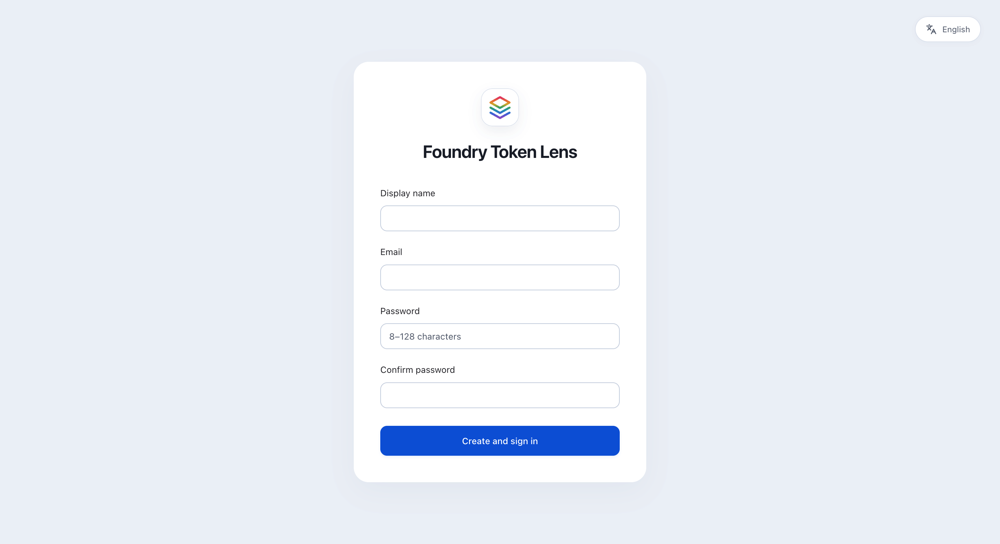

**3. Configuration**

| Variable           | Description                                                                                                                                                                                            | Default                                   |
| ------------------ | ------------------------------------------------------------------------------------------------------------------------------------------------------------------------------------------------------ | ----------------------------------------- |
| `FTL_PUBLIC_URL`   | Platform URL. Overrides the address recorded at setup and the one saved in the single sign-on settings; only requests from it can sign in or change data, and the Entra redirect URI is built from it. | Address recorded at setup                 |
| `FTL_SECRET_KEY`   | Base64-encoded 32-byte master key that encrypts credentials and signs sessions. If it is lost or changed, saved credentials can no longer be decrypted and all sessions end.                           | Generated and saved as `data/.secret-key` |
| `FTL_HOST`         | Listen address                                                                                                                                                                                         | `0.0.0.0`                                 |
| `FTL_PORT`         | Listen port                                                                                                                                                                                            | `8080`                                    |
| `FTL_WEB_DIR`      | Directory of the built UI                                                                                                                                                                              | `dist/web`                                |
| `FTL_DEV_API_PORT` | API port behind the development server                                                                                                                                                                 | `8081`                                    |

## 3. Data management

The platform builds all of its reports from the diagnostic logs of your Foundry resources. To keep costs down, it reads only the logs archived to Blob Storage. Foundry resources offer several diagnostic log categories, and the platform reads only these two:

| Log category                   | Blob container                          | Data provided                                        |
| ------------------------------ | --------------------------------------- | ---------------------------------------------------- |
| **Azure OpenAI Request Usage** | `insights-logs-azureopenairequestusage` | Token usage, time to first and last token            |
| **Request and Response Logs**  | `insights-logs-requestresponse`         | Status code, duration, caller IP, request start time |

> Enable both categories for complete data: with only usage logs there are no status codes or durations; with only request logs there are no tokens, so no cost can be calculated.

### 3.1. Enable diagnostic logs

**1. Add a diagnostic setting**

In the Azure portal, open the Foundry resource, select **Monitoring** > **Diagnostic settings** in the left menu, and select **+ Add diagnostic setting**.\
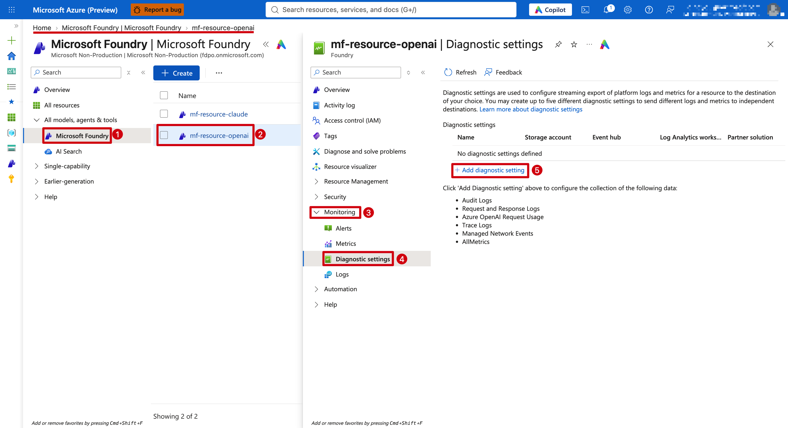

**2. Fill in the setting**

Enter a name for the setting. Under **Logs**, select **Azure OpenAI Request Usage** and **Request and Response Logs**. Under **Destination details**, select **Archive to a storage account**, and then choose the subscription and storage account.\
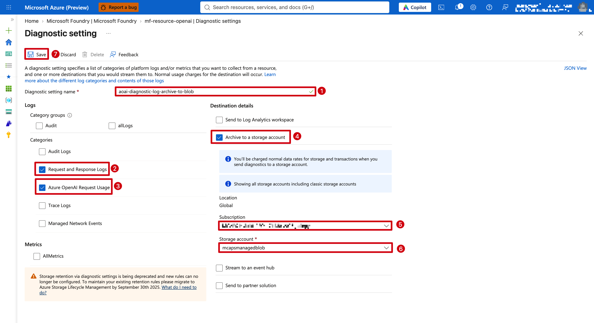

> Each Foundry resource needs its own diagnostic setting. If you have several resources, send them to the same storage account; the platform reads them all.\
> According to Azure, the first logs can take up to about 2 hours to arrive. After that, the two containers in the table above appear under **Containers** in the storage account, and each request's log reaches Blob Storage about 1 minute after the request.

### 3.2. Add a data source

The platform can read the storage account in two ways:

| Method                | When to use                                                                                | What you need                                                             |
| --------------------- | ------------------------------------------------------------------------------------------ | ------------------------------------------------------------------------- |
| **Connection string** | The platform runs anywhere                                                                 | The storage account's connection string                                   |
| **Managed identity**  | The platform runs on Azure (for example, Container Apps) and you don't want to store a key | The storage account name, and read access granted to the managed identity |

**1. Option 1: Use a connection string**

Open the storage account, select **Security + networking** > **Access keys** in the left menu, select **Show keys**, and copy the **Connection string** under **key1**.\
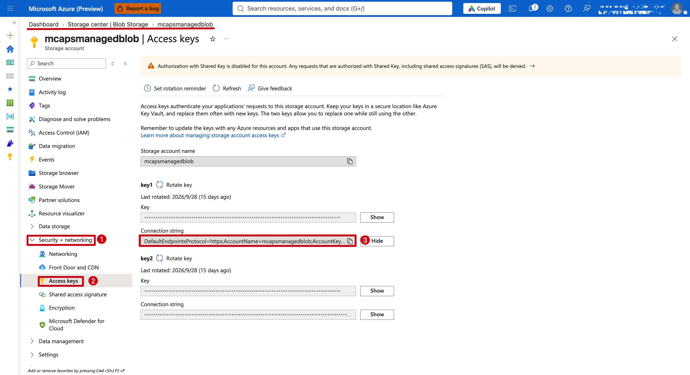

**2. Option 2: Use a managed identity**

1\) Turn on a managed identity for the Azure resource that runs the platform.\
For Container Apps: open the container app, select **Settings** > **Identity**, set **Status** to **On** under **System assigned**, and select **Save**. If you use a user-assigned managed identity, note its client ID.\
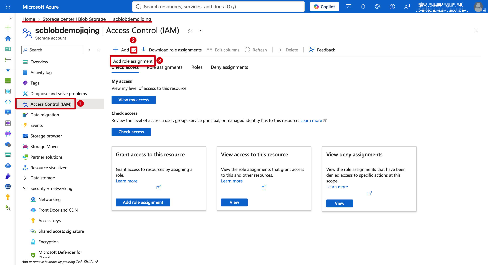

2\) Create a role assignment\
Open the storage account and select **Access control (IAM)** > **+ Add** > **Add role assignment**.\
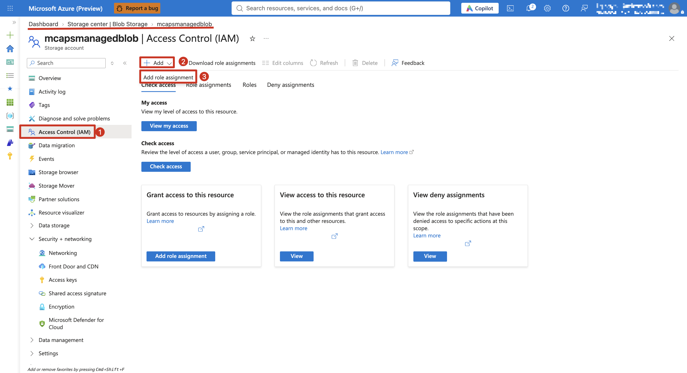

3\) Assign the role\
Choose the `Storage Blob Data Reader` role. Under **Members**, select **Managed identity**, select **+ Select members** and choose the identity from the previous step, and then select **Review + assign**.\
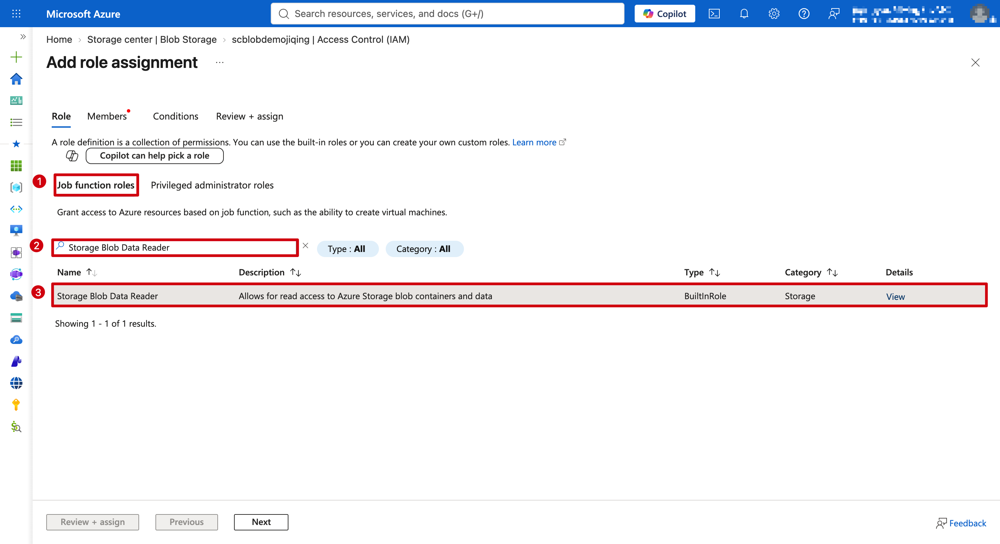

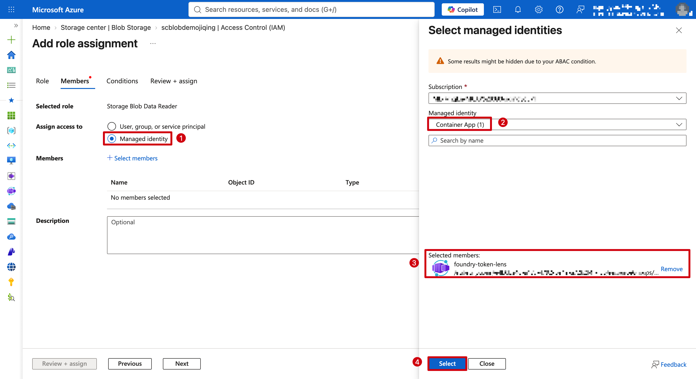

> You must assign `Storage Blob Data Reader`. The Reader and Contributor roles grant only management access, not access to Blob data.\
> Role assignments can take a few minutes to take effect.\
> If the storage account has a firewall, allow access from the platform's network.

**3. Add the data source in the platform with either method**

1\) Go to **Settings** > **Data management**, and on the **Data sources** card select **Add data source**.\
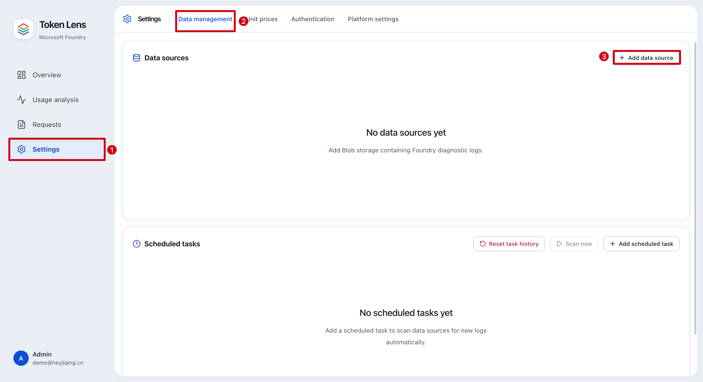

2\) Choose the **Authentication** method:

- **Connection string**: Paste the connection string you copied.
- **Managed identity**: Enter the **Storage Account** name. Leave **Client ID** empty to use the system-assigned identity, or enter the client ID of a user-assigned identity.

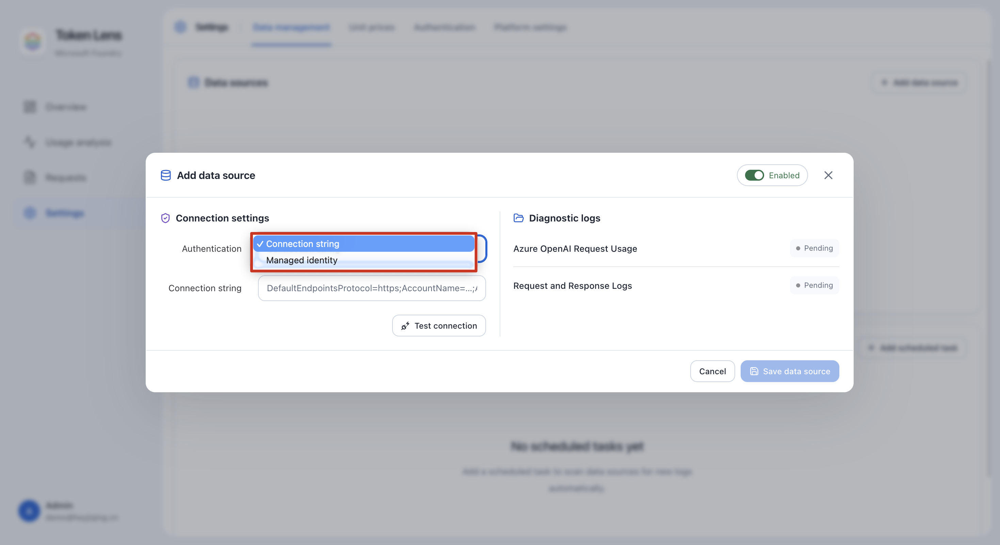

3\) Test and save\
Select **Test connection**. When the connection succeeds, the **Diagnostic logs** section marks each log category as **Identified** or **Not identified**. At least one must be identified before you can select **Save data source**.\
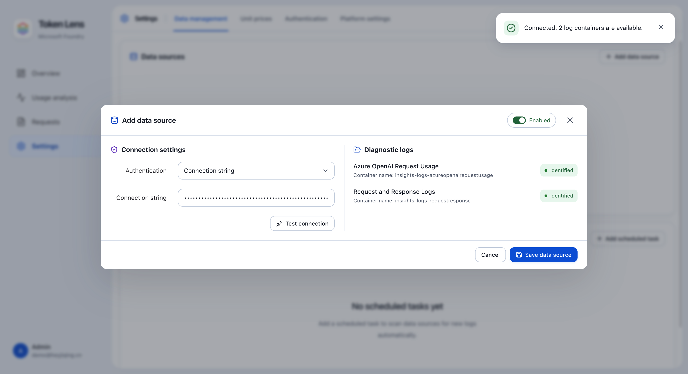

> The **Enabled** toggle in the upper-right corner sets whether the data source is enabled; for a new data source, it is saved with the form.

### 3.3. Manage data sources

You can manage data sources as follows:

- **File statistics**: The data source card shows the number of files and the storage size in Blob Storage; select **Refresh file statistics** to update them.
- **Enable or disable**: A disabled data source is no longer imported, and its data no longer appears in reports.
- **Edit**: A saved connection string is never shown again. Leave the field empty to keep it, or enter a new value to replace it.
- **Delete**: Enter the Blob name in **Confirm Blob name** to confirm. After deletion, the data source's data is no longer imported or shown. Processed log data is kept, and you can use it again by adding the same Blob storage back.

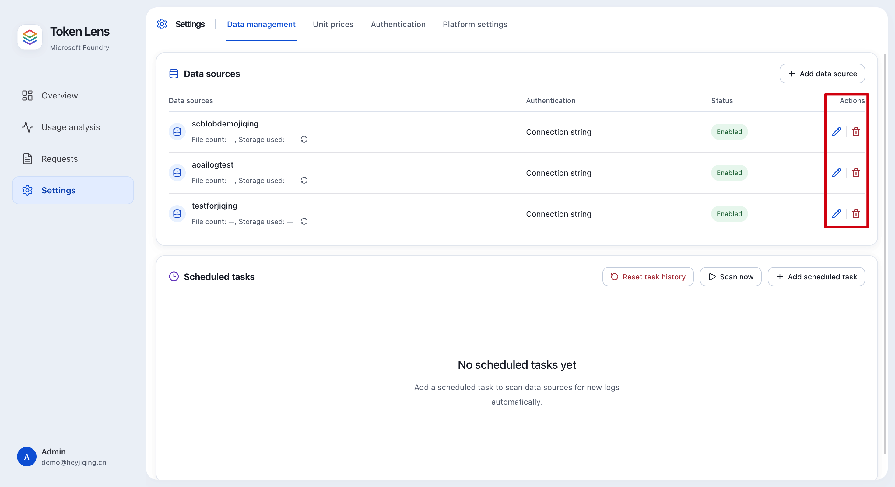

> If the same request appears in two enabled data sources, it counts once in each, and a warning is recorded in the system logs during import.

### 3.4. Add a scheduled task

Scheduled tasks decide when the platform reads new logs from data sources. There are two types:

| Task type               | Purpose                                                                               | Default schedule                                          |
| ----------------------- | ------------------------------------------------------------------------------------- | --------------------------------------------------------- |
| **Routine task**        | Scans at separate daytime and nighttime intervals and reads only new or changed logs  | Daytime 06:00–22:00 every 5 minutes, nighttime every hour |
| **Reconciliation task** | Re-checks the Blob files at a set hour every few days; the first run checks all files | Every day at 06:00                                        |

> Give each data source one routine task and one reconciliation task.

**1. Create a task**

1\) On the **Scheduled tasks** card, select **Add scheduled task**.\
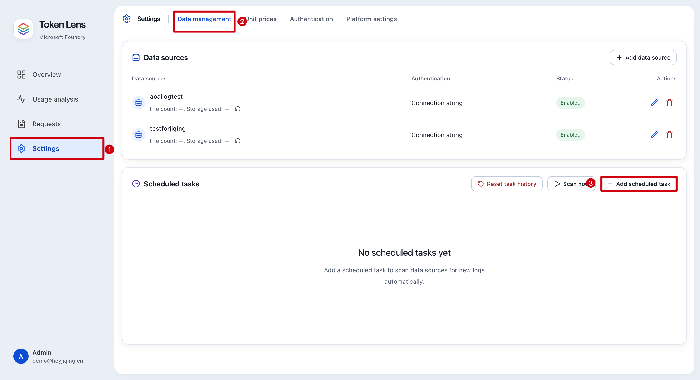

2\) Enter a **Task name**, and choose the **Task type**, **Time zone** and **Linked data sources** (you can select several and search).\
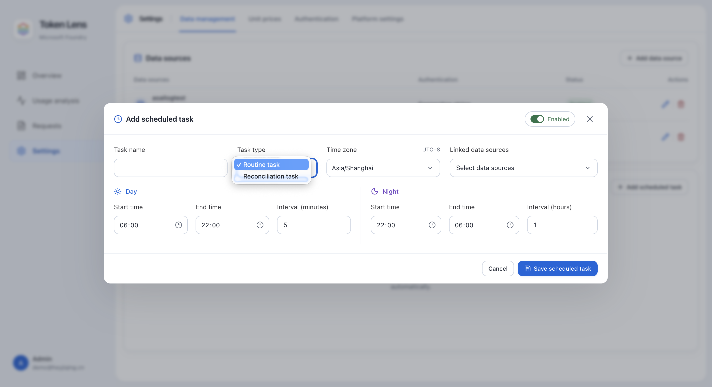

3\) Set the schedule

- **Routine task**: Under **Day**, set the **Start time**, **End time** and **Interval (minutes)**. The rest of the day is **Night**; set its **Interval (hours)**. Each interval must divide its period evenly.
- **Reconciliation task**: Choose the **Reconciliation hour** and the **Frequency (days)**, from 1 to 7 days.

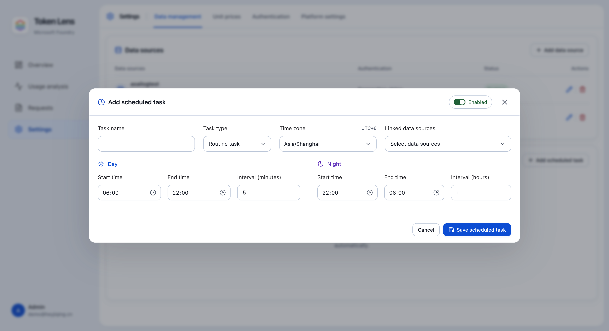

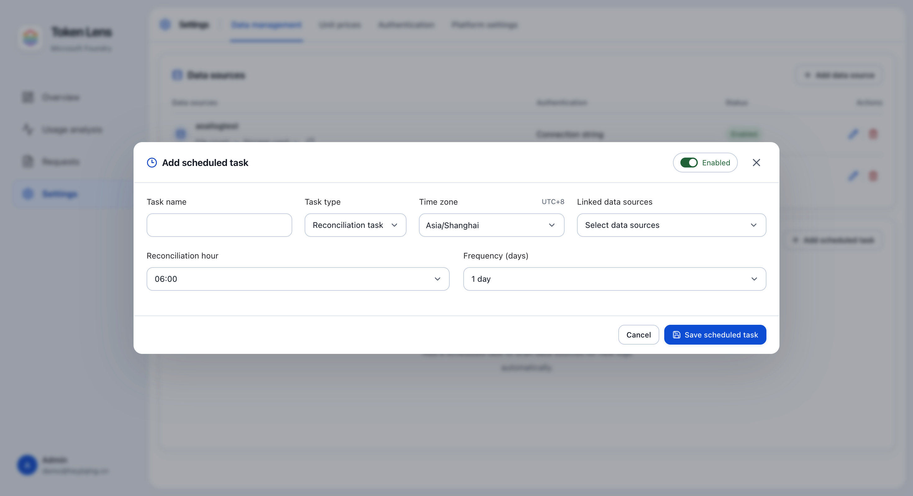

> A data source can be linked to only one enabled routine task and one enabled reconciliation task.

**2. Scan now**

To scan without waiting for the next scheduled run, select **Scan now** on the **Scheduled tasks** card, choose the data sources, and select **Start scan**.

**3. Manage tasks**

- **Enable or disable**: A task's toggle takes effect on its own.
- **Delete**: Stops the task's automatic schedule; data sources and imported logs, usage and costs are kept.
- **Reset task history**: Stops the current task, disables all scheduled tasks, and clears run records, run counts, schedules and reconciliation progress. Task settings, data sources and imported data are kept. When a reconciliation task is enabled again, it runs a full reconciliation.

## 4. Unit prices

The platform doesn't price calls on its own: each model's unit prices are maintained in **Settings** > **Unit prices**.

> Models without a unit price are hidden in reports, filters and exports. Once a price is set, the model's earlier calls are priced at the rates in effect at the time and appear again.

**1. Model list**

After logs are imported, select **Refresh models** to list every model seen in the logs. Model IDs that come from logs can't be changed. You can also select **Add model** and enter a **Model ID** and **Display name**. Each model has the **Edit price**, **Price history** and **Delete model** actions.

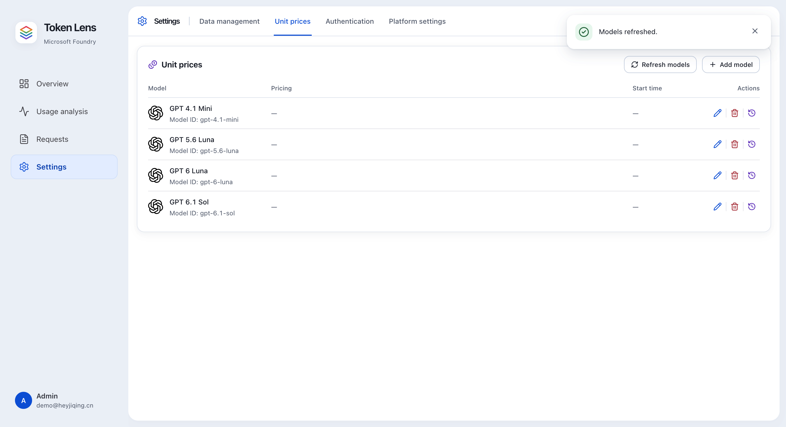

**2. Edit a price**

Unit prices are in **USD / 1M Tokens**, using Global Standard prices by default.

1\) Select **Edit price** and fill in at least one unit price.\
2\) Set the **Start time**, and an **End time (optional)** if needed.\
3\) For a text model whose price depends on context length, turn on **Context tiers**, enter the **Input token threshold** (for example, 272000), and fill in the **Short context** and **Long context** prices.

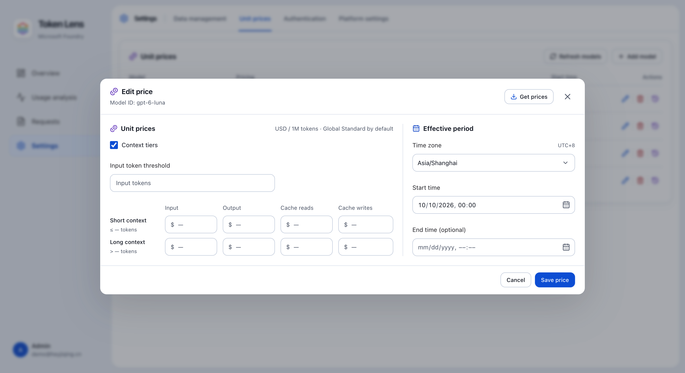

**3. Prefill from Azure retail prices**

While editing a price, select **Get prices** to look up Azure retail prices for the regions of the resources in your logs. Choose a price, select **Fill draft**, check the values, and then select **Save price**. Models without a match, or with billing items beyond the template, need manual entry.

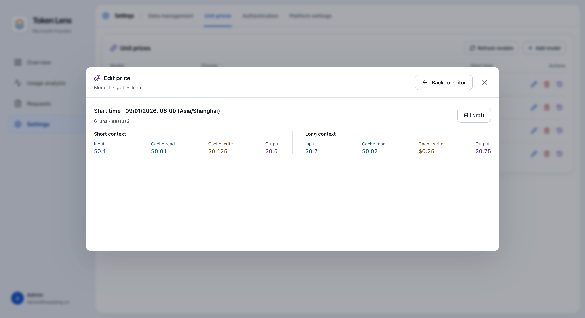

**4. Price history and price changes**

When a price changes, select **New version** in **Edit price** and enter the new **Start time**; the previous version automatically ends at that time. Versions can't overlap. Each version is marked **Active**, **Scheduled** or **Ended**. Each request is billed at the price in effect when it started, and affected requests are recalculated automatically after a price change.

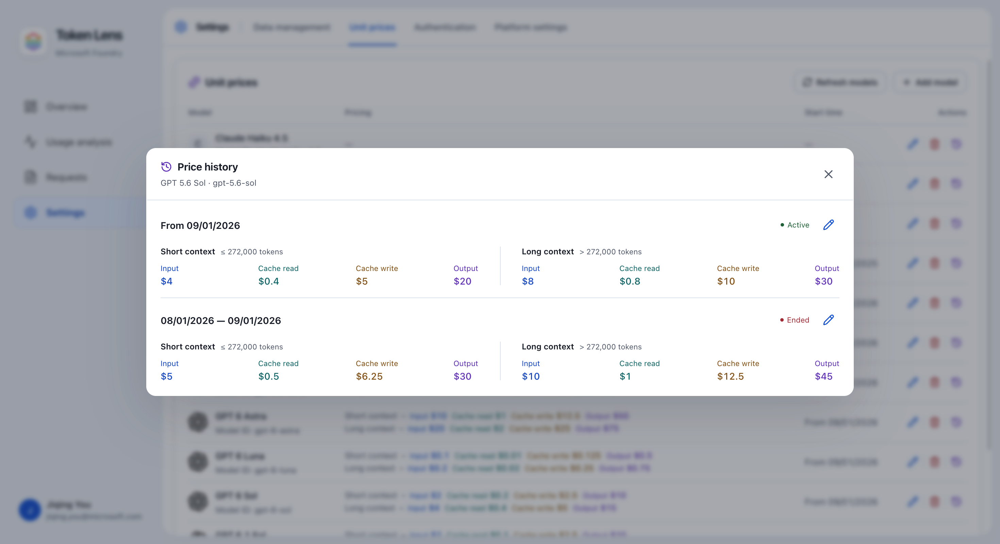

**5. Delete a model**

**Delete model** asks you to enter the model ID to confirm. It deletes the model's price history and calculated costs and removes the model from the list. Logs and usage are kept, and you can set prices again after adding the model back.

## 5. Authentication

### 5.1. Local users

The platform has two roles:

| Role          | Permissions                                                                                                                         |
| ------------- | ----------------------------------------------------------------------------------------------------------------------------------- |
| **Admin**     | View all reports, and manage data sources, scheduled tasks, unit prices, users and platform settings                                |
| **Read-only** | View reports and requests; in **Settings**, only view **Platform settings** without changing anything, and no access to system logs |

**1. Add a user**

1\) On the **Users** card, select **Add user**.\
2\) Enter the **Email**, **Display name** and **Initial password** (8–128 characters), enter the password again in **Confirm password**, and choose a **Role**.\
3\) Select **Create user**.

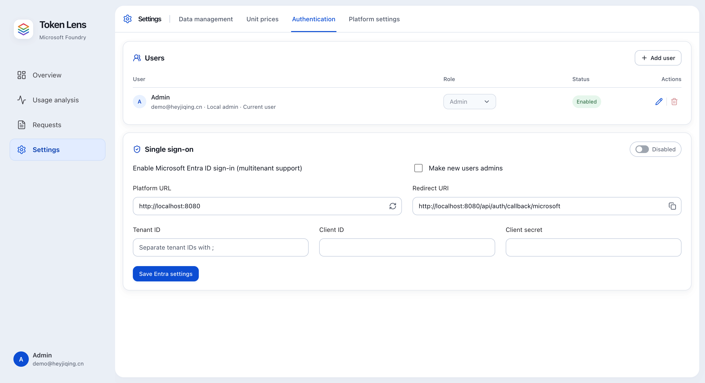

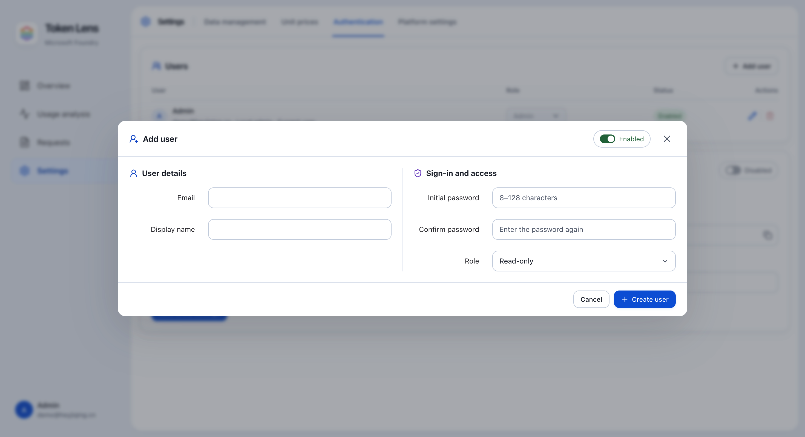

**2. Manage users**

To make sure admin access is never lost, the platform enforces these rules:

> The initial local admin, created during setup, can't be deleted or have its role changed.\
> At least one enabled local admin must remain.\
> You can't change your own role, or disable or delete your own account.

You can:

- Change a user's role directly in the user list.
- Use **Edit user** to update the profile, reset the password, or enable or disable the account. Disabled users can't sign in.
- Use **Delete user** and confirm with the user's email, or with the display name if the user has no email. Deletion removes the account and its sign-in credentials and ends its sessions immediately; historical logs, usage and cost data are kept.

**3. Your account**

Select the user area in the lower-left corner and open **Account** to change your profile and password. Changing your email requires your current password, and changing your password signs out your other sessions.

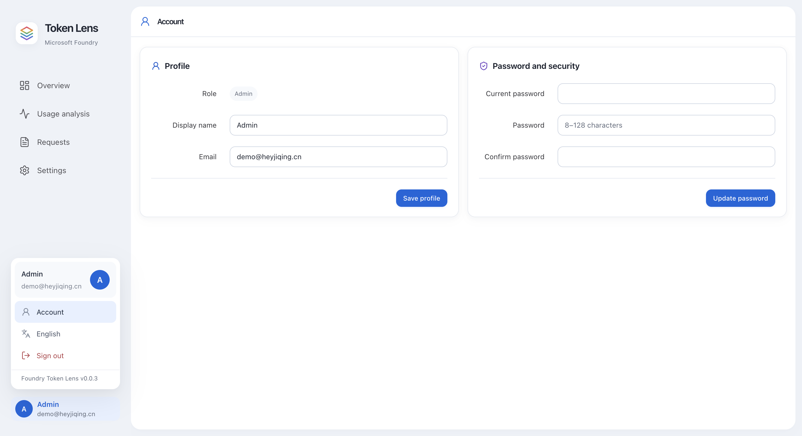

### 5.2. Single sign-on

Once single sign-on is configured, organization users can select **Sign in with Microsoft** on the sign-in page to sign in with their Microsoft Entra ID account.

**1. Register an app**

1\) Create an app registration\
Open **Microsoft Entra ID** > **App registrations** and select **+ New registration**.\
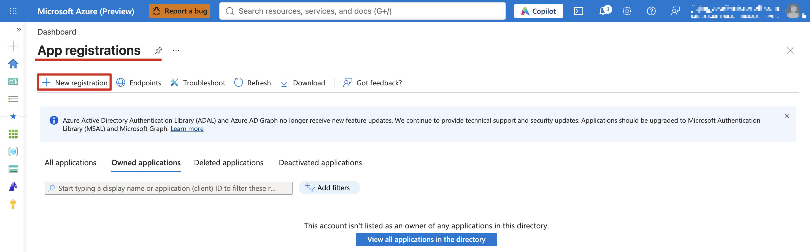

2\) Fill in the registration\
Enter a name, set **Supported account types** to **Multiple Entra ID tenants**, set **Redirect URI** to **Web**, and enter the **Redirect URI** shown on the platform's **Single sign-on** card.\
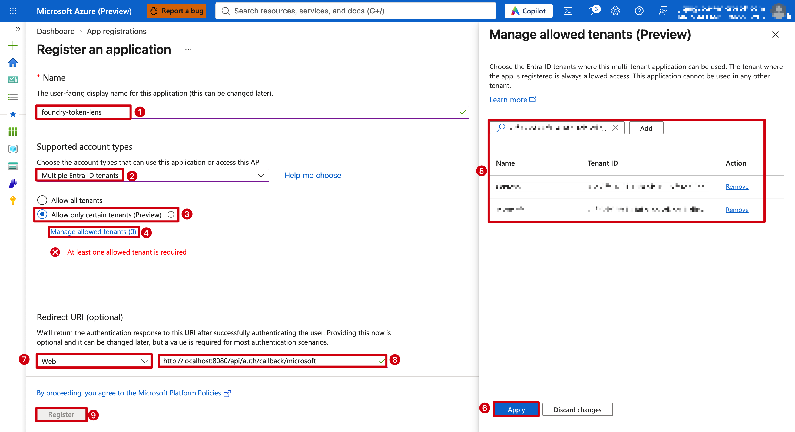

3\) Note the IDs\
On the **Overview** page, note the **Application (client) ID** and **Directory (tenant) ID**.\
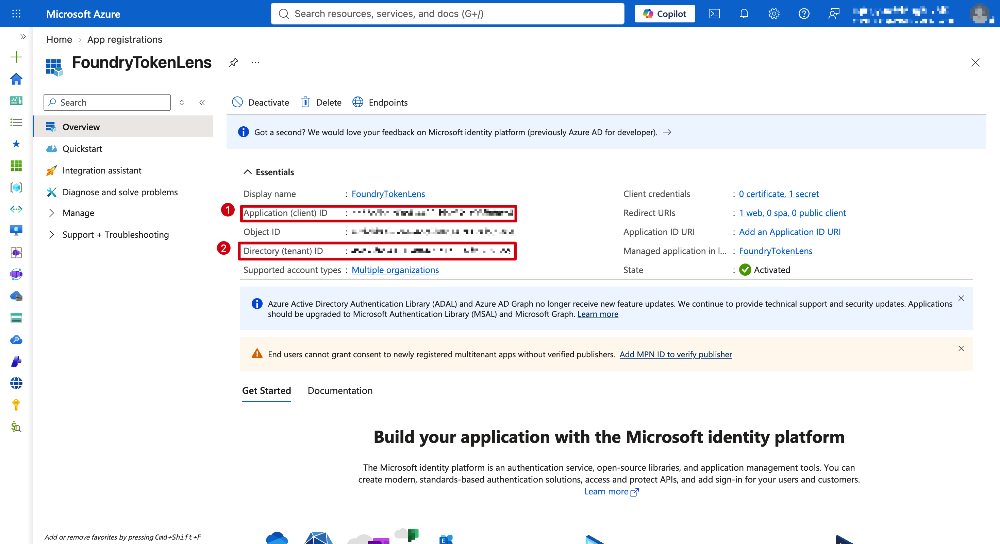

4\) Create a client secret\
Select **Certificates & secrets** > **Client secrets** > **+ New client secret**, enter a description, choose an expiry, and select **Add**.\
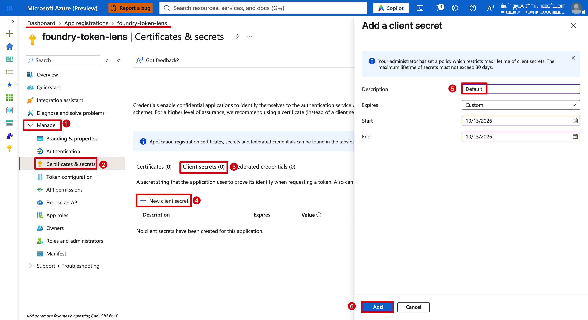

> Copy the new secret's **Value**, not its **Secret ID**; the value can't be viewed again after you leave the page.\
> Create a new client secret before the current one expires, and update it in the platform.\
> The platform requests only the basic profile needed to sign in (openid, profile, email). If your organization doesn't let users consent to apps, a tenant admin must grant consent.

**2. Configure the platform**

1\) Go to **Settings** > **Authentication**, and fill in the **Single sign-on** card:

- **Platform URL**: The address users open the platform at; select **Use current address** to fill it in. Hosted deployments must use HTTPS; HTTP is only for localhost or 127.0.0.1. When `FTL_PUBLIC_URL` is set, it decides this value and the field can't be changed.
- **Redirect URI**: Generated from the **Platform URL**. Copy it into the app registration's **Redirect URI**.
- **Tenant ID**: The tenants allowed to sign in, separated by `;`, up to 20.
- **Client ID** and **Client secret**: The values you noted in the previous section.
- **Make new users admins**: Affects only Entra users signing in for the first time; when it's off, they start as read-only users.

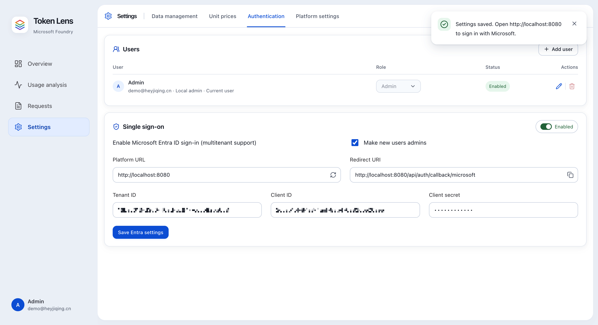

2\) Turn on **Enable Microsoft Entra ID sign-in (multitenant support)** and select **Save Entra settings**. After the first save, the toggle takes effect on its own, without saving again.\
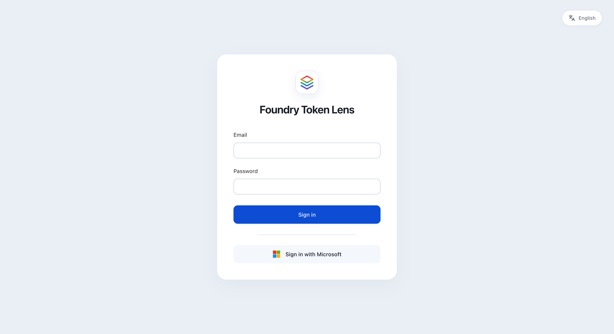

> Entra users get a platform account automatically the first time they sign in, and appear in **Users**. Their passwords and MFA are managed by Microsoft Entra ID.\
> To stop an Entra user from signing in, disable their account. Deleting it only removes the platform account, which is created again the next time they sign in.

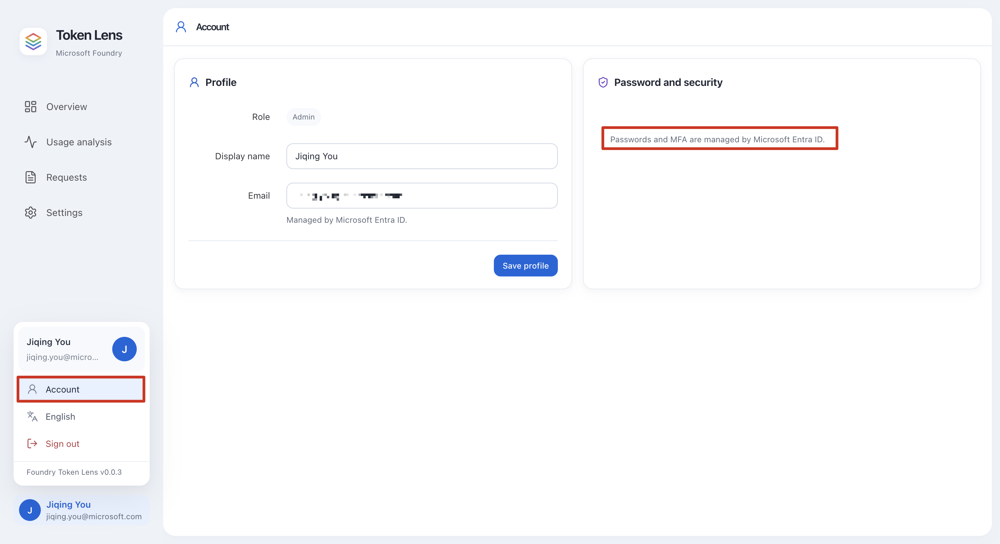

## 6. Platform settings

The **Settings** > **Platform settings** page has two cards: **System data** and **System logs**. Read-only users can open this page but can't change anything.\
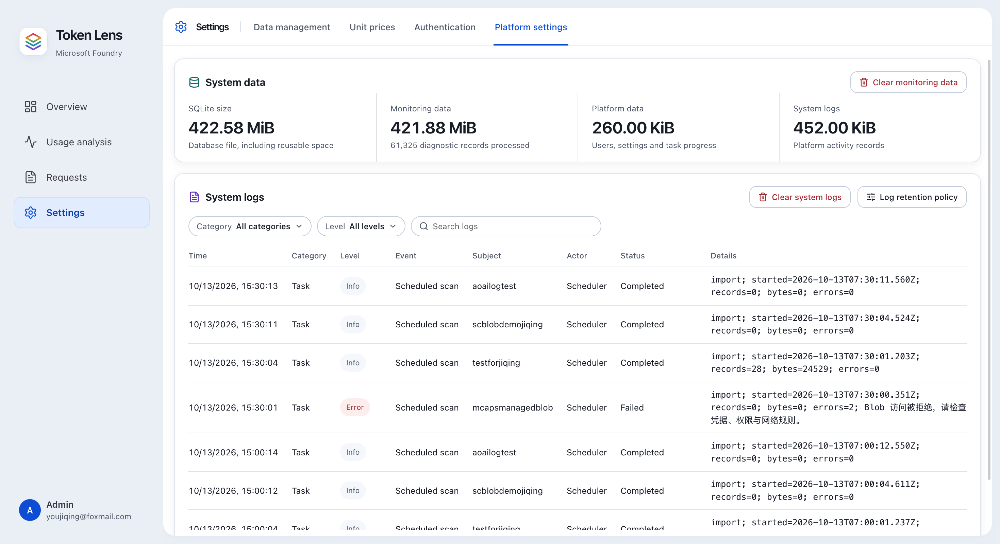

### 6.1. System data

| Item                | Description                                          |
| ------------------- | ---------------------------------------------------- |
| **SQLite size**     | Size of the database file, including reusable space  |
| **Monitoring data** | Processed diagnostic logs with their usage and costs |
| **Platform data**   | Accounts, settings and task progress                 |
| **System logs**     | Records of platform activity                         |

**Clear monitoring data** requires typing `DELETE` to confirm. It stops running tasks, disables all scheduled tasks, and deletes the imported logs with their usage, costs, import checkpoints and reconciliation progress. Users, data sources, prices, task settings and system logs are kept, and the original files in Azure Blob Storage aren't affected; re-enable the tasks to import again.\
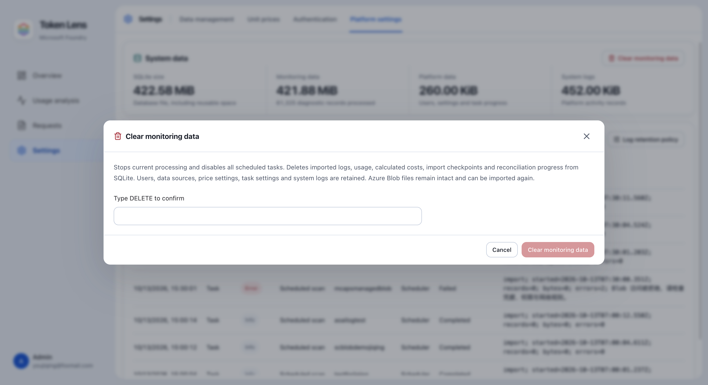

### 6.2. System logs

Only admins can view system logs. They record three categories of events:

- **Task**: Progress and results of scheduled and manual scans.
- **Operation**: Create, update and delete actions by users.
- **System**: Runtime events such as platform startup.

Filter by **Category** and **Level** (**Info**, **Warning**, **Error**), or use **Search logs**. Each entry shows the **Event**, **Subject**, **Actor** and **Details**.

**Log retention policy**

| Setting                         | Description                                                                                                          |
| ------------------------------- | -------------------------------------------------------------------------------------------------------------------- |
| **System log size limit (MiB)** | The oldest logs are removed once the limit is exceeded                                                               |
| **Retention days**              | Logs older than this are removed                                                                                     |
| **Event types to record**       | Multi-select: **Scheduled scan**, **Manual scan**, **Create**, **Update**, **Delete**; select none to record nothing |
| **Levels to record**            | Multi-select: **Info**, **Warning**, **Error**; select none to record nothing                                        |

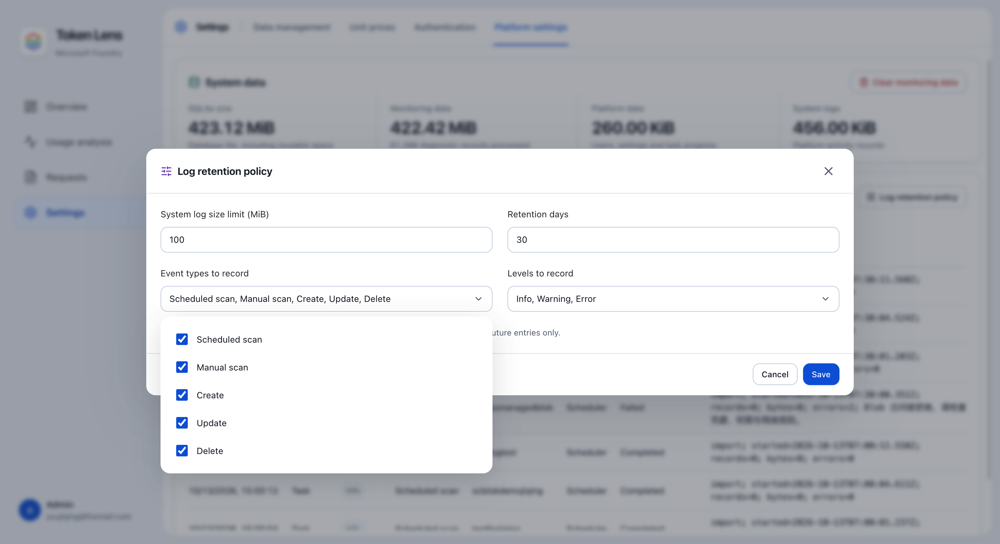

> Whichever limit is reached first, size or age, the oldest logs are removed. Event types and levels only affect future records.

**Clear system logs**

Clears the historical scan, operation and system logs. Running tasks, run counts, processing progress and monitoring data are kept.

## 7. Calculation rules

**1. Merging requests**

- The platform merges the usage log and the request log of the same call into one request by `resourceId` and `correlationId`.
- Tokens come only from usage logs and are never estimated when missing. Times to first and last token also come from usage logs; status code, duration and caller IP come from request logs.
- A request without a request log shows the status **Unknown status**; when the records of one request disagree on the status code, it shows **Field conflict**.
- Reports include only enabled data sources. A request found in two enabled data sources counts once in each.

**2. Request time**

Requests are placed in time buckets by when they started (the request time in the request log), or by when their log was written if there is no request log.

**3. Cost**

- Input tokens already include cache reads and cache writes, so they are billed separately: billed input = input − cache reads − cache writes. Missing cache counts are treated as 0.
- Cost = Σ (quantity of each billing item × unit price) ÷ 1,000,000.
- Each request uses the price version in effect when it started. Costs are recalculated automatically when logs or prices change.
- When a price uses context tiers, a request whose input tokens exceed the threshold is billed as long context, otherwise as short context; prices without tiers count as **Other**. The **Context** filter follows this result.
- Models with no calculated cost yet are hidden in reports, filters and exports.

**4. Tokens and cache**

- Cache hit rate = cache reads ÷ input, counting only requests with a usage log whose cache reads don't exceed their input.
- Cache savings: the cost of the cache-read tokens at the input rate, minus what they actually cost at the cache-read rate.
- Lowest cache hit rate calls: only requests with at least 1,024 input tokens, in two groups, **Non-zero** and **0%**, up to 20 each. Among equal rates, calls with more uncached input tokens come first.

**5. Successful requests and performance**

- A successful request has a request log, a known status code below 400, and no field conflict.
- Duration, time to first token, time to last token and generation speed count only successful requests.
- Generation speed = output tokens ÷ (time to last token − time to first token), in tokens/s; requests with fewer than 100 output tokens are left out.
- P50 / P95: sort the values in ascending order and take the ⌈n × 50%⌉-th / ⌈n × 95%⌉-th value.
- Error rate = requests with a status code ≥ 400 ÷ requests with a known status code.

**6. Comparison and forecast**

- Change vs the previous period: each figure is compared with the immediately preceding period of the same length. For example, when you view the last 14 days, the previous period is the 14 days before them.
- This month's cost forecast:
  - Covers the current calendar month in the report time zone, regardless of the selected time range, but follows other filters such as model and resource.
  - Daily average = month-to-date cost ÷ days elapsed (at least 1 day); month-end forecast = month-to-date cost + daily average × days remaining.
  - **Last month total** is the total cost of the previous calendar month, shown for reference.
